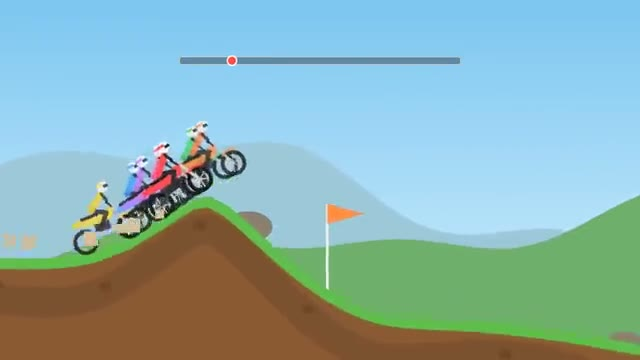

# Trial Bikes

Gas, lean, flip. Don't land on your head. A multiplayer starter game from [Multiplayer Agent](https://multiplayeragent.com): 2D, versus, 2–8 players, with bots that fill empty seats.

## How it plays

Race dirt bikes over hills, jumps and steps while everyone else rides beside you as a ghost. Lean to land on both wheels: a flip takes a second off your time, a crash sends you back to the last checkpoint.

**Controls:** Up to gas, Down to brake, Left/Right to lean, R for the checkpoint, or on-screen buttons.

## Make it yours in the Game Builder

Open the [Game Builder](https://multiplayeragent.com), choose **Start from a starter game** and pick Trial Bikes. It opens as version 1 in your studio, ready to play and publish. Then ask for changes, for example:

- Add a loop-the-loop on the first track
- Add a nitro button that refills at each checkpoint
- Make it a snowmobile race in the mountains

## Run it yourself

1. Get a free publishable key (`pk_…`) at [multiplayeragent.com](https://multiplayeragent.com).
2. In `index.html`, put it in place of `pk_REPLACE_ME` in the `MP_CONNECT` block.
3. Open `index.html` in a browser. No build step and no server needed.

Without a key it still runs, offline against bots.

## How it is built

- One `index.html`. The comment at the top of the script maps the code and explains the multiplayer.
- **Leaderboard:** The best time on each of the three tracks.
- **Host-run rounds:** The host's browser starts each race, picks the track and posts the results; if it leaves, the next player takes over.
- **Bots:** Bots ride, flip and sometimes crash, until enough people join.
- **Live sync:** Every bike rides the same track for everyone at once, as see-through ghosts.
- `?attract` runs it offline with bots only. The preview video is recorded from it.

## License

MIT.
